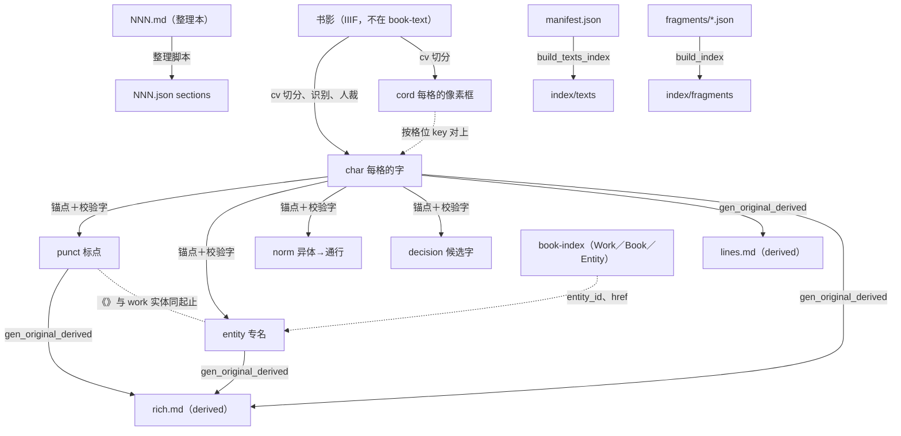

# 00 总览：book-text 里的全部文件

> 状态：正式（2026-10-09，overview#497 定稿）。本篇是 book-text 文件体系的总入口；每种文件的字段级定义见各分篇。
> 读法：先看 §一 的总表找到文件，再看 §三 的依赖表知道改了它要重生什么，字段细节进对应分篇。

---

## 一、所有文件一张表

book-text 仓按条目组织：每个 Work 或 Book 一个**条目目录** `<Work|Book>/<c1>/<c2>/<c3>/<id>/`，其下是 `manifest.json` 和若干**版本目录** `<key>/`（目录布局、分片规则见 [07](./07-book-text-条目布局.md)）。

- **真源**：仓里别的文件算不出来，改它要靠人、模型或入库脚本。
- **生成**：由脚本从真源算出来，**不手改**。
- **存在哪**：`main`＝book-text 主分支；`derived`＝生成分支（只由脚本写，不往回并，见 §五）。
- **版本号跟谁走**：只有 `original` 跟踪内容版本（三条线：文本、标点、实体，见 §四）；其余文件不编版本。

### 1.1 条目层（所有条目都有）

| 代号 | 文件名模式 | 真源／生成 | 由谁生成、从哪来 | 存在哪 | 版本号 | 规范 |
|---|---|---|---|---|---|---|
| manifest | `<id>/manifest.json` | 真源 | 入库脚本（overview `scripts/book-text/add_text.py` 等）写；人可改 | main | 不编 | [07 §二](./07-book-text-条目布局.md) |
| index | `<id>/<key>/index.json` | 真源（original 的 `*_version` 三项是镜像，见 §四） | 入库脚本写；original 的版本号由 `bump_original.py` 改 | main（derived 上另加 `lines_file`、`rich_file`） | 不编（original 见 §四） | [07 §三](./07-book-text-条目布局.md) |
| md | `<id>/<key>/NNN.md` | 真源 | 转录：入库脚本从维基／Kanripo／识典转来；整理本：人工整理 | main | 不编 | [03](./03-guji-markdown.md)、[07 §四](./07-book-text-条目布局.md) |
| sections | `<id>/<key>/NNN.json` | **生成**（由同名 `NNN.md` 派生；见 07 §四·2） | 整理脚本 | main | 不编 | [07 §四·2](./07-book-text-条目布局.md) |
| pages | `<id>/<key>/pages.tsv` | 真源 | Kanripo／CBETA 入库脚本 | main | 不编 | [07 §四·3](./07-book-text-条目布局.md) |
| fragments | `Work/…/<id>/fragments/<书名>.json` | 真源 | 辑佚整理 | main | 不编 | [07 §五](./07-book-text-条目布局.md) |
| sources | `Work/…/<id>/sources/<来源>/…` | 真源（抓取原件） | 抓取脚本 | main | 不编 | [07 §五](./07-book-text-条目布局.md) |
| extra | `<id>/<key>/extra/…` | 真源（附件） | 整理者 | main | 不编 | [07 §五](./07-book-text-条目布局.md) |
| texts-index | `index/texts/{0-f}.json` | **生成** | `build_texts_index.py`，汇总全部 manifest | main | 不编 | [07 §六](./07-book-text-条目布局.md) |
| fragments-index | `index/fragments/{0-f}.json` | **生成** | `build_index.py`，汇总全部 fragments | main | 不编 | [07 §六](./07-book-text-条目布局.md) |

### 1.2 `original` 每章一组（只用于本项目从书影做出来的文本）

`original` 是 manifest 里 `is_original: true` 的那个版本（现在是四庫總目 `96mid1ogzk` 的 `default/`，见 07 §二·3）。每章（＝每册）一组文件，**代号就是文件名里的那个词**，`NNN` 是三位章号。

| 代号 | 文件名 | 真源／生成 | 由谁生成、从哪来 | 存在哪 | 版本号跟谁 | 规范 |
|---|---|---|---|---|---|---|
| **char** | `NNN.char.json` | 真源 | open-guji-cv 切分识别＋人裁（guji-workspace）导出 | main | **文本线**：char 顶层 `version` | [02](./02-guji-char.md) |
| **cord** | `NNN.cord.json` | 真源 | open-guji-cv 切分导出 | main | 不编（`producers` 记来源提交） | [01](./01-guji-cord.md) |
| **punct** | `NNN.punct.json` | 真源 | 大模型断句＋规则分段＋人工补，锚在 char 上 | main | **标点线**：punct 顶层 `version` | [04](./04-guji-punct.md) |
| **entity** | `NNN.entity.json` | 真源 | 大模型识别＋键表匹配 book-index＋人工，锚在 char 上 | main | **实体线**：entity 顶层 `version` | [05](./05-guji-entity.md) |
| **norm** | `NNN.norm.json` | 真源 | 异体对照表或人工，锚在 char 上 | main | 不编（见 06 §四） | [06](./06-guji-norm.md) |
| **decision** | `NNN.decision.json` | 真源 | CV／外部模型出候选，Claude 道入库 | main | 不编 | [08](./08-guji-decision.md)（草案部分待用户拍板） |
| **lines** | `NNN.lines.md` | 生成 | `gen_original_derived.py`：char → lines | derived | 跟 char | [03 §三](./03-guji-markdown.md) |
| **rich** | `NNN.rich.md` | 生成 | `gen_original_derived.py`：char＋punct＋entity → rich | derived | 跟 char、punct、entity | [03 §四](./03-guji-markdown.md) |
| changes | `CHANGES.md`（版本目录下一份） | 真源（日志） | `bump_original.py` 每次升版本追加一行 | main | — | [07 §三·4](./07-book-text-条目布局.md) |

---

## 二、派生关系图

---

## 三、「改了 A 要重生哪些」

| 改了 | 必须跟着做 | 校验 |
|---|---|---|
| **char**（改字、改格位） | ① 升文本线（`bump_original.py --line text`）；② 逐个核 punct、entity、norm、decision 的锚点校验字：全对得上的只把 punct／entity 的 `text_version` 跟过去，对不上的修好后各自升版本；③ 重生 lines、rich（derived）；④ cord 的格位若变了要同步改 cord | F-OV-01／02、cord 每格 `a` 在 char 里 |
| **cord** | 无生成物。格位 key 不能出现 char 里没有的 | cord 每格 `a` 在 char 里 |
| **punct** | ① 升标点线；② 重生 rich；③ `index.json` 的 `punct_version` 镜像由脚本同步 | F-OV-01；《》与 work 实体同起止 |
| **entity** | ① 升实体线；② 重生 rich；③ `index.json` 的 `entity_version` 镜像同步；④ 动了 work 实体的起止，要同步改 punct 的《》 | F-OV-01；《》与 work 实体同起止 |
| **norm** | 现在无生成物（rich 暂不套 norm）；不升任何线 | 每条 `a`、`c` 对得上 char |
| **decision** | 无生成物；不升任何线。裁定后真要改字，改的是 char（走第一行） | F-OV-05 |
| **manifest**（加删版本、改 label、chapters_total） | 重生 `index/texts`（`build_texts_index.py --root`） | 校验器 F-MF-01 |
| **整理本 `NNN.md`** | 重生同名 `NNN.json` | md／json 同步巡检（见 07 §四·2） |
| **fragments** | 重生 `index/fragments`（`build_index.py`） | F-FR-01 |
| 章节增删（index.json 的 `chapters`） | manifest 的 `chapters_total`、index.json 的 `total_chapters` 一起改，再重生 `index/texts` | F-FT-01 |

开 PR 前的整套动作见 book-text `CLAUDE.md`：合 main → 重建 `index/texts` → `validate_text_format.py --strict --baseline` → `validate-collated.py`。

---

## 四、坐标、偏移与版本线（各分篇共用的定义）

### 4.1 两种坐标

| 名字 | 写法 | 谁用 |
|---|---|---|
| **cell（格位 key）** | `<页>:<列>:<格>[子列]`，如 `3:5:12`、`3:4:6a`、`3:4:-1`；正则 `^\d+:\d+:-?[1-9]\d*[ab]?$` | char（定义处）、cord、punct、entity、norm、decision |
| **box（像素框）** | `[x, y, w, h]`，IIIF Canvas 像素，左上原点 | 只在 cord |

格位 key 的完整定义（页、列、格、子列怎么数）在 [02 §二](./02-guji-char.md)。格位 key 只在**一章之内**唯一；跨章引用写 `v<册>/<格位>`（只用于深链，文件里不写）。

### 4.2 字下标（offset）

punct 的 `char_offset`、entity 的 `span.start_offset／end_offset` 都用同一个**字下标**：

- 把同章 char 的 `pages[].columns[].cells[]` **按数组顺序**排成一条字流（这就是阅读顺序，双行夹注已是先 a 后 b）；
- 某格的字下标＝它在这条字流里的位置，**从 0 起**；
- 每格算一个，正文、单行小注、双行夹注、阙文 `□` 都计；版面空格、空列不在 char 里，不计。

字下标只是**缓存**：以格位 key 为准；char 改了以后字下标由脚本重算。

### 4.3 三条版本线（只管 `original`）

| 线 | 跟踪的文件 | 版本号记在 | index.json 镜像 |
|---|---|---|---|
| 文本 | char | char 顶层 `version` | 章条目 `text_version` |
| 标点 | punct | punct 顶层 `version`（另记 `text_version`：对着哪一版文本做的） | 章条目 `punct_version` |
| 实体 | entity | entity 顶层 `version`（另记 `text_version`） | 章条目 `entity_version` |

- 都是 `MAJOR.MINOR.PATCH`：major＝质量等级（1 可用、2 出版级、3 定本），minor＝较大改动，patch＝小范围改动（一次 PR 一册 ≤约 50 处）。
- **文本线可停在 0.x**（GUJI-543/548）：粗校完的第一版是 **0.1.0**，可以并 main；精校完才是 1.0.0。文本线低于 0.1.0 不进 main。标点、实体线从 1.0.0 起，文本线还在 0.x 时不得有这两条线。
- major ≥2 必须带验收记录 `review`（`date`、`signed_by`、`sample`），并要用户点头；脚本不自动升 major。
- 伴生层的 major 不得高于文本线；伴生层 `text_version` 不得超前于当前文本。
- **`text_version` 同步规则**：文本线升版本后，伴生层 `text_version` 落后时，要逐个核锚点校验字——全对得上的由 `bump_original.py --line text` 把 `text_version` 跟过去（伴生层自己的版本不升），对不上的修好后各自升版本（F-OV-01／02）。
- **`proofing`（校对状态）**：章条目的布尔开关。文本线 0.x（精校未完）时必须为 `true`；≥1.0.0 时可写 `true`（旧定义的 1.0.0 补走精校）或不写。网站据此挂「欢迎帮助校对」banner，不从版本号推（F-OV-06）。
- **`pending_file`**（册级待审清单 `NNN.pending.json`）：仅 `proofing: true` 的册可有，由整理侧导出；顶层 `rev`（`<册>-r<n>`）、`cv_commit`（必填）、`cv_version`（首个正式 tag 前可 null）、`cells`（先只列格号＋review 状态）；不是版本线（F-OV-07）。
- 文本线 0.x 的册章条目须同时声明 `char_file` 与 `cord_file`（精校页按格位查像素框，F-OV-04）。
- 每次升版本在 `CHANGES.md` 记一行。
- 等级门槛与 minor／patch 的分界全文见 overview `项目进展/古籍文本/整体设计/2026-10-文本版本号与仓库流程.md`（v2），04 §五、05 §八 各摘本线一份。
- cord、norm、decision、manifest、转录本、整理本都**不跟踪内容版本**。

### 4.4 格式版本

每种 JSON 文件顶层用 `$schema` 写格式版本（URL，如 `https://open-guji.org/schema/char/v0.1.json`），对应本仓 `schemas/` 下的同名文件。**`version` 是内容版本，不是格式版本。**例外：norm 现用 `"schema": "guji-norm/0.2"`（下一版统一为 `$schema`，见 06）。

| 文件 | 现行格式版本 | schema |
|---|---|---|
| cord | 0.1 | `schemas/guji_cord_v0.1.schema.json` |
| char | 0.1 | `schemas/guji_char_v0.1.schema.json` |
| punct | **0.2**（0.1 文件仍合法） | `schemas/guji_punct_v0.2.schema.json` |
| entity | **0.2** | `schemas/guji_entity_v0.2.schema.json`（0.1 留档） |
| norm | 0.2 | `schemas/guji_norm_v0.2.schema.json` |
| decision | 0.2（0.1 文件仍合法） | `schemas/guji_decision_v0.2.schema.json` |
| manifest | 1 | `schemas/book_text_manifest_v1.schema.json` |
| index | 1 | `schemas/book_text_index_v1.schema.json` |

---

## 五、生成分支 `derived`

- 每个提交＝main 某提交的整棵树＋各 original 版本目录下的 `NNN.lines.md`、`NNN.rich.md`；该版本 `index.json` 的章条目另加 `lines_file`、`rich_file`。提交说明写源提交号。
- 只由 `publish_original_derived.sh`（调 `gen_original_derived.py`）写；不手改，不往回并 main。
- 合入动到 original 的 PR 后，由合 PR 的人重新生成并推送。
- 标点层有条目缺 `anchor`、或伴生层锚点与 char 对不上时，该章只出 lines、不出 rich。

---

## 六、规范目录

| 篇 | 管什么 |
|---|---|
| [01 guji-cord](./01-guji-cord.md) | 每格像素框 |
| [02 guji-char](./02-guji-char.md) | 每格的字，文本唯一真源；格位 key 定义 |
| [03 guji-markdown](./03-guji-markdown.md) | 章文件 `NNN.md` 的记法；lines.md、rich.md 的生成规则 |
| [04 guji-punct](./04-guji-punct.md) | 标点、分段、书名号 |
| [05 guji-entity](./05-guji-entity.md) | 专名与专名号，链 book-index |
| [06 guji-norm](./06-guji-norm.md) | 异体→通行字 |
| [07 book-text 条目布局](./07-book-text-条目布局.md) | 条目目录、manifest、index、章文件、辑佚、汇总索引 |
| [08 guji-decision](./08-guji-decision.md) | 拿不准的字的候选 |
| [syntax](./syntax.md)、[directives](./directives.md)、[ast](./ast.md)、[conformance](./conformance.md) | 古籍 Markdown 记法、中间表示、输出与一致性测试 |
