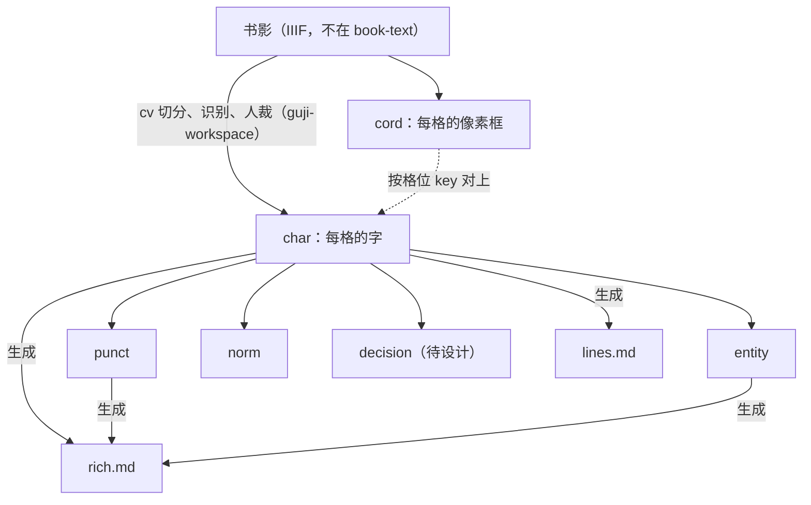

# 格式总览：开源古籍数字化标准体系（guji-format）

> 本规范定义了开源古籍数字化平台从图像到文本、排版、标点与校勘的全链路数据格式。
> 遵循原则：**信息只增不减、层次逐级派生、正文与标注解耦**。

---

## 一、文件与关系（2026-10-06 用户定）

只用于 book-text 的 `original`（本项目从书影做出来的文本）。每章一组文件，**代号就是文件名里的那个词**：

| 代号 | 文件 | 是什么 | 性质 | 存在哪 |
|---|---|---|---|---|
| **char** | `NNN.char.json` | 每一格定下的字和版式（[02](./02-guji-char.md)）。**文本版本号跟踪它** | 真源 | main |
| **cord** | `NNN.cord.json` | 每一格的像素框，不存字（[01](./01-guji-cord.md)） | 真源 | main |
| **punct** | `NNN.punct.json` | 标点、分段、书名号（[04](./04-guji-punct.md)） | 真源 | main |
| **entity** | `NNN.entity.json` | 专名，链 book-index（[05](./05-guji-entity.md)） | 真源 | main |
| **norm** | `NNN.norm.json` | 异体→通行字，按格位 | 真源 | main |
| **decision** | `NNN.decision.json` | 不确定的字的其他候选 | 真源 | **待设计**，先留白 |
| **lines** | `NNN.lines.md` | 由 char 生成：一列一行（[03](./03-guji-markdown.md)） | 生成 | 生成分支 |
| **rich** | `NNN.rich.md` | 由 char＋punct＋entity（＋norm）生成的阅读稿 | 生成 | 生成分支 |

- **两种坐标**：**cell** 是格位 key `页:列:格[子列]`（如 `3:5:12a`），char、punct、entity、norm 都用它；**box** 是像素框 `[x, y, w, h]`，只在 cord 里。
- 原来的 Level 1／2／3 说法不再用：原 guji-page（Level 1）在 book-text 里的存储形态拆成 cord（几何）和 decision（候选），原 guji-cell（Level 2）改名 char 并去掉候选，Level 3a 就是 lines，Level 3b（reflow）不再单独生成。
- 生成物不进 main：main 只存真源，lines、rich 由脚本从 main 生成，放在单独的生成分支上。前端读哪些文件由网站决定。

---

## 二、字形三维度规范（正交变换）

在生成的 Markdown（lines、rich）里，正交支持三种字形展现形式，由字符转换器按需派生：

1. **原刻底本（`original`）**：
   - 100% 忠实保留刻本原字（含刻本异体字、避讳缺笔字、俗体字、组字式）；
   - 来源：`text` 原样字符流。
2. **通行繁体（`traditional`）**：
   - 保持文言繁体语感，但将生僻异体字平滑替换为通行规范繁体字（例如将底本的 `𢰅` 映射为 `撰`，`內/内` 归一）；
   - 来源：通过 `norm` 规范层字典映射。
3. **现代简体（`simplified`）**：
   - 面向大众阅读，经 OpenCC（`t2cn`）繁简转换器输出大陆规范简体字；
   - 专名与古籍常见繁简词库经过定制对齐。

---

## 三、规范详细目录索引

- [01-guji-cord 规范：字框坐标，不存字 (v0.1)](./01-guji-cord.md)
- [02-guji-char 规范：定字文本，文本唯一真源 (v0.1)](./02-guji-char.md)
- [03-guji-markdown 规范：古籍 Markdown 排版与分行分段 (v0.2)](./03-guji-markdown.md)
- [04-guji-punct 规范：独立外挂标点格式 (v0.1)](./04-guji-punct.md)
- [05-guji-entity 规范：独立外挂命名实体与知识图谱链接格式 (v0.1)](./05-guji-entity.md)
  - 04、05 两份伴生层的 `version`／`text_version` 是内容版本号（book-text `original` 三线独立 semver），见各自「§5 版本号」。
