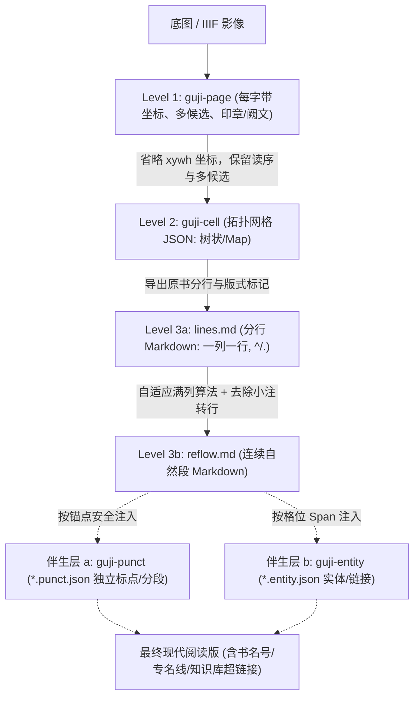

# 格式总览：开源古籍数字化标准体系（guji-format）

> 本规范定义了开源古籍数字化平台从图像到文本、排版、标点与校勘的全链路数据格式。
> 遵循原则：**信息只增不减、层次逐级派生、正文与标注解耦**。

---

## 一、格式分层架构

数字化链路划分为四个核心层次与一个外挂伴生层：

| 层次 | 格式名称 | 扩展名 / 存储形态 | 坐标与空间 | 核心职责 |
| :--- | :--- | :--- | :--- | :--- |
| **Level 1** | **`guji-page`** | `pNNNN.guji-page.json` | IIIF Canvas 像素 `[x,y,w,h]` | **物理真源**：记录每字具体坐标、OCR 备选概率、定字置信度、版面区域与印章污损。 |
| **Level 2** | **`guji-cell`** | `*.guji-cell.json` | 无坐标（基于拓扑格序） | **版面拓扑**：保留册/页/列/格层级与夹注分栏结构，包含字符备选，支持树状与扁平 Map 两种形态。 |
| **Level 3a** | **`lines.md`** | `*.lines.md` | 文本分行 | **刻本分行 Markdown**：忠实保留原书一列一行、行首抬头 `^`、挪抬 `.`、双行夹注 `<a\|b>`。 |
| **Level 3b** | **`reflow.md`** | `*.reflow.md` / `*.md` | 篇章自然段 | **可阅读 Markdown**：经满列自适应算法合并为连贯自然段，消除竖排小注断行，保留页码锚点。 |
| **伴生层 a** | **`guji-punct`** | `*.punct.json` | 字符锚点偏移量 / 拓扑格位 | **独立外挂标点**：记录在第几个字后插入标点与自然段换行，正文原字 100% 不受影响，支持随时切换标点版本。 |
| **伴生层 b** | **`guji-entity`** | `*.entity.json` | 拓扑格位 Span `[start, end]` | **独立外挂实体与超链接**：记录人名、地名、书名、官职等实体及其关联到 `book-index` 知识库的 URI，未录入者标记为候选。 |

---

## 二、字形三维度规范（正交变换）

在 Level 3 的 Markdown 层级中，正交支持三种字形展现形式，由字符转换器按需派生：

1. **原刻底本（`original`）**：
   - 100% 忠实保留刻本原字（含刻本异体字、避讳缺笔字、俗体字、组字式）；
   - 来源：`text` 原样字符流。
2. **通行繁体（`traditional`）**：
   - 保持文言繁体语感，但将生僻异体字平滑替换为通行规范繁体字（例如将底本的 `𢰅` 映射为 `撰`，`內/内` 归一）；
   - 来源：通过 `norm` 规范层字典映射。
3. **现代简体（`simplified`）**：
   - 面向大众阅读，经 OpenCC（`t2cn`）繁简转换器输出大陆规范简体字；
   - 专名与古籍常见繁简词库经过定制对齐。

---

## 三、规范详细目录索引

- [01-guji-page 规范：带坐标的页面文本与 OCR 候选 (v0.1)](./01-guji-page.md)
- [02-guji-cell 规范：无坐标的版面拓扑与字符网格 (v0.1)](./02-guji-cell.md)
- [03-guji-markdown 规范：古籍 Markdown 排版与分行分段 (v0.2)](./03-guji-markdown.md)
- [04-guji-punct 规范：独立外挂标点格式 (v0.1)](./04-guji-punct.md)
- [05-guji-entity 规范：独立外挂命名实体与知识图谱链接格式 (v0.1)](./05-guji-entity.md)
